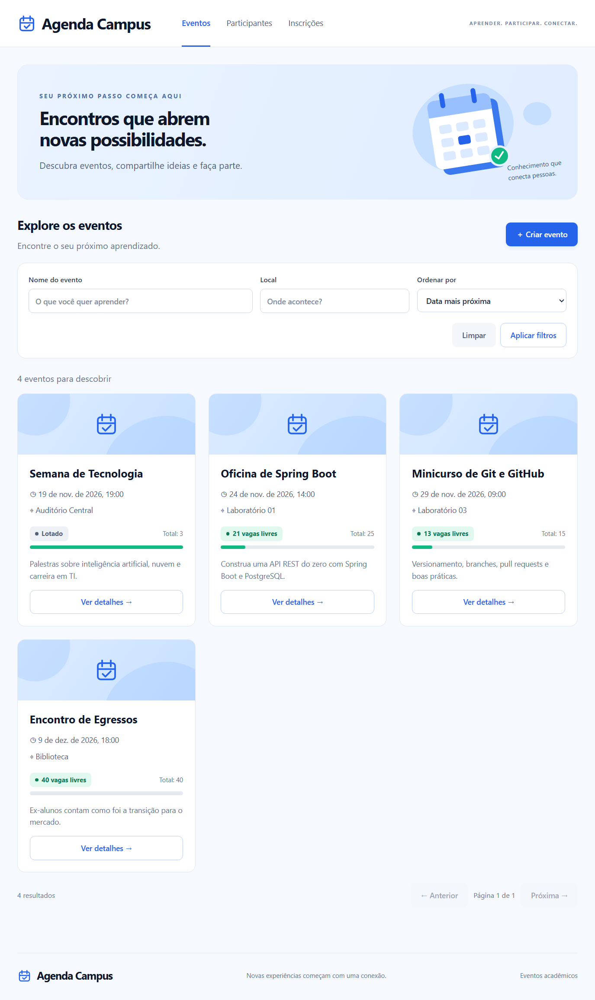
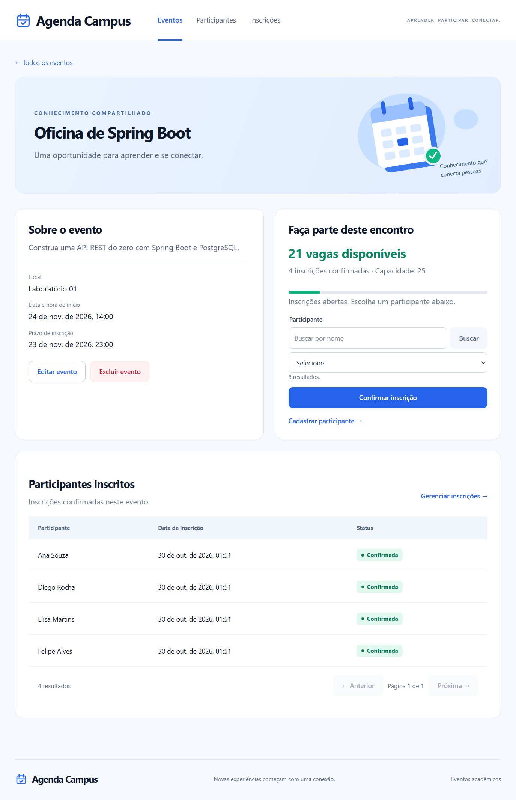
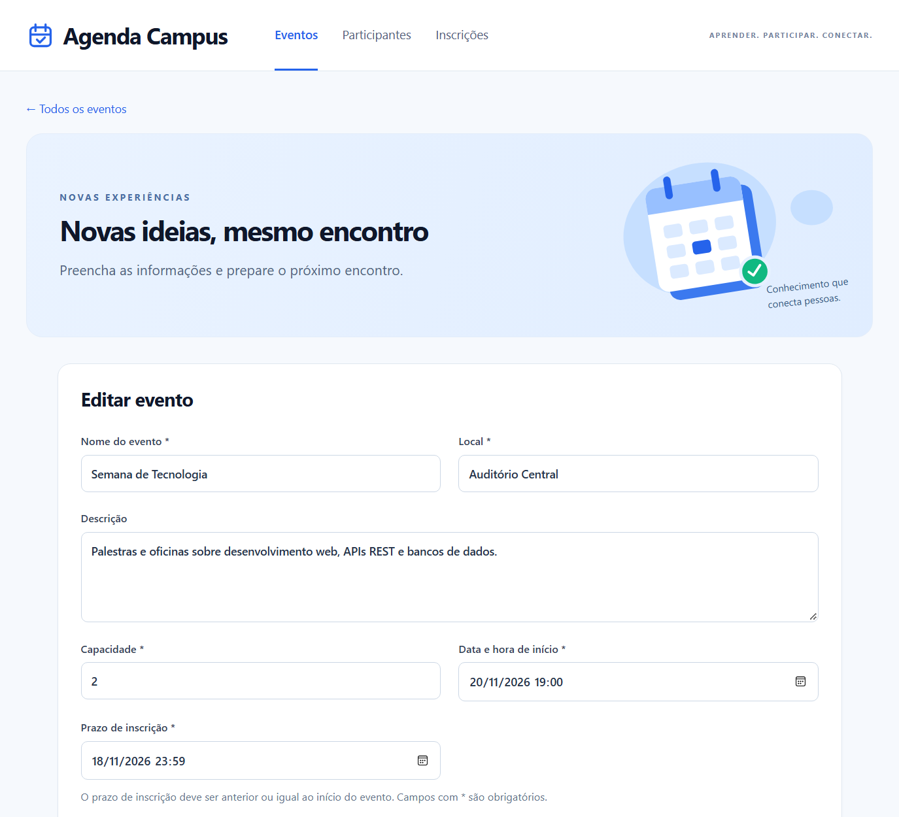
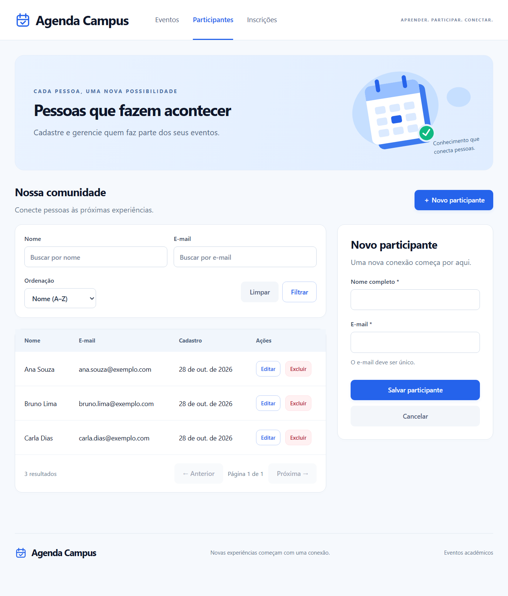
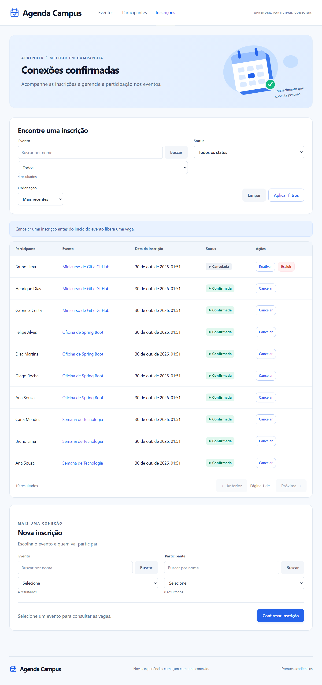
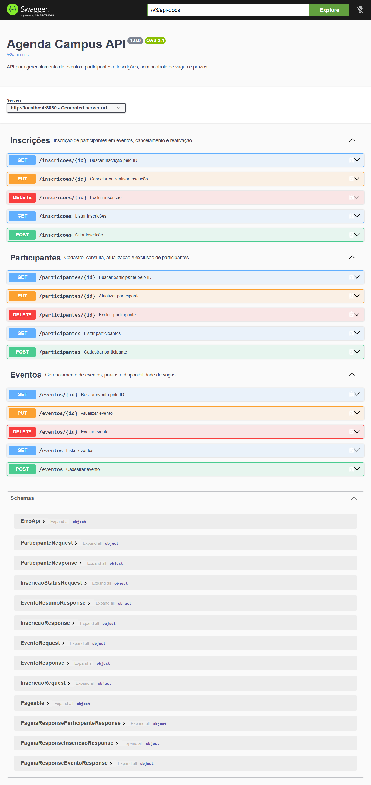
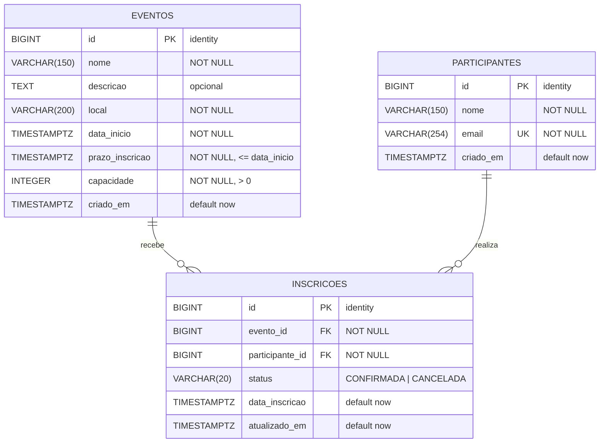

# Agenda Campus — API REST e interface web



## Sumário

1. [Sobre o projeto](#sobre-o-projeto)
2. [Requisitos atendidos](#requisitos-atendidos)
3. [Vídeo de demonstração](#vídeo-de-demonstração)
4. [Como executar](#como-executar)
5. [Prints](#prints)
6. [Tecnologias](#tecnologias)
7. [Arquitetura e estrutura](#arquitetura-e-estrutura)
8. [Diagrama do banco de dados](#diagrama-do-banco-de-dados)
9. [Endpoints](#endpoints)
10. [Regras de negócio](#regras-de-negócio)

## Sobre o projeto

O Agenda Campus é uma API REST com interface web para gerenciar eventos
acadêmicos (palestras, oficinas, minicursos e encontros), os participantes e as
inscrições, com controle de vagas e prazos de inscrição.

- **Eventos:** cadastro, edição e exclusão, com nome, local, descrição, data de
  início, prazo de inscrição e capacidade. A lista tem busca por nome e local
  e ordenação.
- **Participantes:** cadastro com e-mail único, edição, exclusão e busca por
  nome ou e-mail.
- **Inscrições:** inscrição de participantes em eventos, cancelamento (que libera
  a vaga), reativação e exclusão de inscrições canceladas.
- **Controle de vagas:** as vagas disponíveis são calculadas a partir das
  inscrições confirmadas, e inscrições simultâneas nunca ultrapassam a capacidade.
- **Documentação interativa** da API com Swagger UI.

## Requisitos atendidos

| Requisito | Como o projeto atende |
|---|---|
| 2.1 Estrutura e organização | Java 21 e Spring Boot 4.1, em camadas `controller`, `service` e `repository`, com Spring Data JPA e PostgreSQL ([arquitetura](#arquitetura-e-estrutura)) |
| 2.1 Entidades relacionadas com `@OneToMany` e `@ManyToOne` | 3 tabelas: `eventos` e `participantes`, ligadas por `inscricoes` (N:N). `Inscricao` tem `@ManyToOne` para `Evento` e `Participante`, que têm o `@OneToMany(mappedBy)` de volta ([diagrama](#diagrama-do-banco-de-dados)) |
| 2.2 CRUD completo | Criar, listar, buscar por ID, atualizar e excluir em eventos, participantes e inscrições ([endpoints](#endpoints)) |
| 2.3 DTOs | Pacote `dto`: records `...Request` recebem e validam os dados, records `...Response` são devolvidos pela API, e `PaginaResponse` representa as listagens paginadas. A conversão é manual: o service cria a entidade a partir do Request, e os métodos `Response.de(entidade)` fazem o caminho inverso. Nenhuma entidade JPA nem objeto interno do Spring é exposto |
| 2.4 `ResponseEntity` e status HTTP | Todos os métodos dos controllers devolvem `ResponseEntity`: `200`, `201` com `Location`, `204`, e `400`/`404`/`409` pelo tratamento de erros ([status e erros](#status-http-e-tratamento-de-erros)) |
| 2.5 Validação e exceções | `@NotBlank`, `@NotNull`, `@Size`, `@Email` e `@Min` nos DTOs; erros tratados em um único ponto com `@RestControllerAdvice` (um `@ControllerAdvice`) e `@ExceptionHandler`, no padrão ProblemDetail |
| 2.6 Filtragem de dados | Filtros combináveis por URL nas três listagens, feitos com métodos derivados do Spring Data (`findBy...`): nome e local, nome e e-mail, evento e status ([filtros](#filtros-paginação-e-ordenação)) |
| 2.7 Regras de negócio | Controle de vagas, prazos, e-mail e inscrição únicos, bloqueio de exclusão com vínculos, cancelamento e reativação, vagas calculadas e proteção contra inscrições simultâneas, todas na camada de service ([regras](#regras-de-negócio)) |
| 2.8 Swagger | springdoc-openapi, com descrição, parâmetros, respostas e possíveis erros de cada endpoint em `/swagger-ui/index.html` |
| **Extra:** telas conectadas ao backend | Interface web em HTML, CSS e JavaScript que consome a API ([prints](#prints)) |

## Vídeo de demonstração

**[Assistir ao vídeo de demonstração](COLE_AQUI_O_LINK_DO_VIDEO)**

## Como executar

### Pré-requisitos

- **JDK 21** ou mais recente (`java -version` deve indicar 21 ou superior)
- **PostgreSQL** em execução (versão 13 ou superior recomendada)
- Não é necessário instalar o Maven: use o wrapper `mvnw` / `mvnw.cmd`

### 1. Criar o banco

Crie um banco vazio chamado `eventos_db`. As tabelas são criadas automaticamente
pelo Flyway na primeira execução.

```sql
CREATE DATABASE eventos_db;
```

### 2. Configurar a conexão

A aplicação lê a conexão de variáveis de ambiente:

| Variável | Padrão |
|---|---|
| `DB_URL` | `jdbc:postgresql://localhost:5432/eventos_db` |
| `DB_USERNAME` | `postgres` |
| `DB_PASSWORD` | `root` |

Defina apenas as que forem diferentes do padrão.

### 3. Iniciar a aplicação

Na raiz do projeto:

**Windows (PowerShell)**

```powershell
$env:DB_PASSWORD = 'senha do seu PostgreSQL'
.\mvnw spring-boot:run
```

**Linux / macOS**

```bash
DB_PASSWORD='senha do seu PostgreSQL' ./mvnw spring-boot:run
```

**IntelliJ IDEA:** execute a classe `AgendaCampusApplication`, adicionando
`DB_PASSWORD` (e as demais variáveis, se necessário) nas variáveis de ambiente
da configuração de execução.

### 4. Acessar

| Recurso | Endereço |
|---|---|
| Interface web | http://localhost:8080/ |
| Swagger UI | http://localhost:8080/swagger-ui/index.html |

## Prints

### Detalhes do evento



### Cadastro e edição de evento



### Participantes



### Inscrições



### Swagger UI



## Tecnologias

| Camada | Tecnologia |
|---|---|
| Linguagem | Java 21 |
| Framework | Spring Boot 4.1 (Web MVC, Data JPA, Validation) |
| Banco de dados | PostgreSQL |
| Migrações | Flyway |
| Documentação | springdoc-openapi 3.1 (Swagger UI) |
| Interface web | HTML, CSS e JavaScript puros, servidos pelo próprio Spring Boot |
| Build | Maven (Maven Wrapper incluído) |

## Arquitetura e estrutura

```
agenda-campus/
├── pom.xml, mvnw, mvnw.cmd
├── docs/imagens/             prints usados neste README
└── src/
    └── main/
        ├── java/com/faculdade/eventos/
        │   ├── controller/   endpoints REST, sempre com ResponseEntity
        │   ├── dto/          dados recebidos (Request, com validações) e devolvidos (Response)
        │   ├── service/      regras de negócio e conversão entre DTOs e entidades
        │   ├── repository/   acesso ao banco e consultas dos filtros
        │   ├── model/        entidades JPA e seus relacionamentos
        │   ├── exception/    tratamento centralizado de erros
        │   └── config/       documentação do Swagger
        └── resources/
            ├── application.properties
            ├── db/migration/ scripts Flyway de criação das tabelas
            └── static/       interface web (HTML, CSS, JS)
```

## Diagrama do banco de dados



`INSCRICOES` é a tabela associativa do relacionamento N:N entre eventos e
participantes. No código, `Inscricao` mapeia as chaves estrangeiras com
`@ManyToOne`, e `Evento` e `Participante` têm a lista de inscrições com
`@OneToMany(mappedBy = ...)`, usada para impedir a exclusão de registros com
inscrições vinculadas.

## Endpoints

Base: `http://localhost:8080`. A documentação completa, com os corpos de
requisição e resposta, está no Swagger UI.

### Eventos

| Método | Endpoint | Descrição |
|---|---|---|
| GET | `/eventos` | Lista os eventos (filtros por nome e local) |
| GET | `/eventos/{id}` | Busca evento por ID, com as vagas disponíveis |
| POST | `/eventos` | Cadastra evento |
| PUT | `/eventos/{id}` | Atualiza evento |
| DELETE | `/eventos/{id}` | Exclui evento sem inscrições |

### Participantes

| Método | Endpoint | Descrição |
|---|---|---|
| GET | `/participantes` | Lista os participantes (filtros por nome e e-mail) |
| GET | `/participantes/{id}` | Busca participante por ID |
| POST | `/participantes` | Cadastra participante |
| PUT | `/participantes/{id}` | Atualiza participante |
| DELETE | `/participantes/{id}` | Exclui participante sem inscrições |

### Inscrições

| Método | Endpoint | Descrição |
|---|---|---|
| GET | `/inscricoes` | Lista as inscrições (filtros por evento e status) |
| GET | `/inscricoes/{id}` | Busca inscrição por ID |
| POST | `/inscricoes` | Inscreve participante em evento |
| PUT | `/inscricoes/{id}` | Cancela ou reativa inscrição |
| DELETE | `/inscricoes/{id}` | Exclui inscrição cancelada |

Corpo das requisições de inscrição:

```jsonc
// POST /inscricoes
{ "eventoId": 1, "participanteId": 3 }

// PUT /inscricoes/{id}  (CANCELADA para cancelar, CONFIRMADA para reativar)
{ "status": "CANCELADA" }
```

A resposta traz a inscrição com os dados do evento e do participante.

### Filtros, paginação e ordenação

Todos os filtros são opcionais e podem ser combinados.

| Recurso | Parâmetros de filtro |
|---|---|
| Eventos | `nome`, `local` (parte do texto, sem diferenciar maiúsculas) |
| Participantes | `nome`, `email` (parte do texto, sem diferenciar maiúsculas) |
| Inscrições | `eventoId`, `status` (`CONFIRMADA` ou `CANCELADA`) |

Todas as listagens são paginadas e aceitam `page` (padrão `0`), `size`
(padrão `10`) e `sort` (padrão `id,asc`). Exemplos:

```
GET /eventos?nome=semana&local=auditorio&sort=dataInicio,asc
GET /participantes?email=exemplo.com&page=0&size=5
GET /inscricoes?eventoId=1&status=CONFIRMADA
```

### Status HTTP e tratamento de erros

| Código | Quando acontece |
|---|---|
| `200 OK` | Consulta ou atualização realizada |
| `201 Created` | Cadastro realizado; o cabeçalho `Location` traz o endereço do novo recurso |
| `204 No Content` | Exclusão realizada |
| `400 Bad Request` | Campos inválidos, JSON malformado, parâmetro ou campo de ordenação inválido, datas incoerentes |
| `404 Not Found` | Evento, participante ou inscrição não encontrados |
| `409 Conflict` | Violação de regra de negócio: evento lotado, prazo encerrado, inscrição ou e-mail duplicados, exclusão com vínculos |
| `500 Internal Server Error` | Erro inesperado, com mensagem genérica, sem expor detalhes internos |

As exceções são tratadas em um único ponto, o `ApiExceptionHandler`
(`@RestControllerAdvice` com um `@ExceptionHandler` para cada tipo de erro), e todos os
erros seguem o padrão ProblemDetail (RFC 9457). Os erros da API trazem mensagens em português:

```json
{
  "title": "Conflito",
  "status": 409,
  "detail": "O evento não possui vagas disponíveis",
  "instance": "/inscricoes"
}
```

Nos erros de validação (`400`), a resposta também traz o campo `campos`, com a
mensagem de cada campo inválido.

## Regras de negócio

**Eventos**
- Nome, local, data de início, prazo de inscrição e capacidade são obrigatórios.
- A capacidade deve ser maior que zero e não pode ficar abaixo das inscrições confirmadas.
- Um novo evento deve começar no futuro, e o prazo de inscrição não pode ser posterior ao início.
- Na edição, uma nova data de início também deve ser futura.
- Só pode ser excluído se não tiver inscrições, inclusive canceladas.

**Participantes**
- Nome e e-mail são obrigatórios; o e-mail deve ser válido e único.
- O e-mail é salvo sem espaços nas extremidades e em letras minúsculas.
- Só pode ser excluído se não tiver inscrições, inclusive canceladas.

**Inscrições**
- Cada participante tem no máximo uma inscrição por evento; uma inscrição
  cancelada pode ser reativada sem criar outro registro.
- Inscrever ou reativar exige prazo aberto, evento não iniciado e vaga disponível.
- Cancelar libera a vaga e só é permitido antes do início do evento.
- Só inscrições canceladas podem ser excluídas.
- Inscrições simultâneas não ultrapassam a capacidade: o evento é travado
  (`@Lock(PESSIMISTIC_WRITE)` no método `findComBloqueioById`) enquanto as vagas são conferidas.

Vagas disponíveis = capacidade − inscrições confirmadas.
